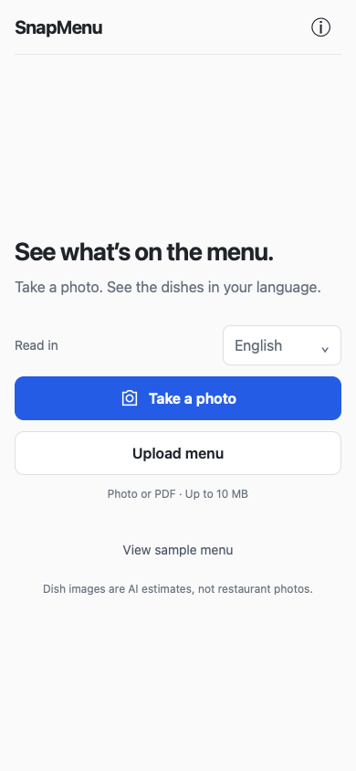

# SnapMenu

Take a photo of a restaurant menu and see the dishes in your language. Built for travellers and restaurants whose menus have no pictures.

The app uses one screen, system fonts, and large touch controls. Choose a photo or take one; extraction starts immediately. Dish cards appear first. AI pictures fill in as they finish. Next and Back replace scrolling through a long menu. Short screens show two dishes; taller screens show four. Tap a dish for its original name, description, and printed price.

## Runtime

Everything runs on Cloudflare. There is no Python production server and no Next.js adapter.

```text
Phone: React + Base UI
  ├─ resize photo / render PDF locally
  └─ Cloudflare Worker (TypeScript)
       ├─ Meta or OpenAI API
       ├─ D1: private menus, tasks, request budgets
       └─ R2: private dish pictures
```

Set `AI_PROVIDER=muse` or `AI_PROVIDER=openai` on the server:

| Provider | Menu extraction | Dish rendering | Secret |
| --- | --- | --- | --- |
| Muse, default | `muse-ember-1.0` | `muse-image-1.0` | `MODEL_API_KEY` |
| OpenAI | `gpt-6-luna` | `gpt-image-2.5-flare` | `OPENAI_API_KEY` |

Muse uses Meta's [Model API](https://dev.meta.ai/docs/overview). Menu extraction requests strict JSON schema output without response storage. Images use background Responses so reloads can recover the same task. The provider is saved with each task, so changing the flag cannot route an old task to the wrong provider.

Muse Image uses a single refinement pass and disables web search, image search, and shell tools. OpenAI uses Flare at medium quality. The browser requests only visible dish pictures, with up to three in progress. Completed images are reused. Unconfirmed submissions are never automatically repeated.

## Local development

Use Node 22.19 or later. Node 26.5 was used for the recorded verification.

```sh
npm ci
cp .dev.vars.example .dev.vars
npm run build
npm run db:local
npm run dev:worker
```

Put your provider key in ignored `.dev.vars`. Never put keys in `VITE_*` variables. Open [localhost:8787](http://127.0.0.1:8787). The sample menu works without credentials and makes no AI requests.

For frontend hot reload, run `npm run dev` in another terminal. Vite forwards `/api` to the local Worker. Test the production build through Wrangler before release.

Phone photos resize to a maximum of 1800 pixels before upload. JPG, PNG, WebP, and other browser-decodable photos are accepted. HEIC support depends on the browser; unsupported photos show an error. PDFs with 1–3 pages render on the device. PDF code loads only after a PDF is selected. Input files must be at most 10 MB.

## Cloudflare release

The Worker, D1 migration, R2 binding, static assets, and hourly expiry job are configured in `wrangler.jsonc`. The D1 ID is a placeholder until provisioning. No live Cloudflare deployment has been performed for this rebuild.

```sh
npx wrangler d1 create snapmenu
npx wrangler r2 bucket create snapmenu-images
# Put the returned D1 database ID in wrangler.jsonc.
npx wrangler d1 migrations apply snapmenu --remote
npx wrangler secret put MODEL_API_KEY
npm run deploy
```

For OpenAI, set the provider flag to `openai` and use `npx wrangler secret put OPENAI_API_KEY`. Keep both keys configured while tasks from both providers remain pending. Use private R2 storage; do not enable public bucket access.

See [operations](docs/operations.md) for recovery, existing data, and release checks.

## Privacy and limits

No account is required. A seven-day, HTTP-only browser cookie authorizes private menus and images. SnapMenu does not retain the original uploaded photo. It stores extracted text and generated pictures for seven days. Deletion removes local menu data and pictures, and attempts to cancel pending provider tasks.

AI pictures are illustrations, not photos of the restaurant's actual food. Prices remain as printed. Ask the restaurant about ingredients and allergies.

Extraction uses `store=false`. Background images use `store=true` for recovery. After saving an image, SnapMenu requests deletion of the provider response. Closing the browser can defer retrieval and deletion until the menu returns or the expiry job runs. Provider retention rules still apply; a deletion request does not promise immediate physical erasure.

Default caps are 100 scans and 100 pictures per rolling day across the app, including failed submissions. Each browser can request 10 scans and 20 pictures per hour. Change the server settings deliberately; set a daily cap to zero to stop new requests. These are request caps, not currency budgets.

## Verification and evaluation

The current build is exercised through real browsers and Cloudflare's local Worker runtime, D1, and R2. Only external provider HTTP is simulated. [Verification evidence and limits](docs/verification.md) records the final run.

```sh
npm run check
python3 -m venv .venv
.venv/bin/python -m pip install -r requirements-dev.txt
.venv/bin/python -m playwright install chromium webkit
npm test
```

Five Terra agents collected **50 real text-only menus from distinct SF restaurants**. Original files, source URLs, dates, hashes, and partial dish/price checks live in [the evaluation corpus](evals/menus/README.md). Some menus are historical or samples. The corpus is not served to diners. It has 40 development cases and 10 fixed holdout cases.

```sh
# Offline validation; no AI requests.
.venv/bin/python evals/menus/prepare.py
# Five real extraction calls against your running, credentialed Worker.
.venv/bin/python evals/menus/run.py --limit 5 --allow-paid
```

Live provider quality and latency remain unverified. No Meta key is configured locally. The existing OpenAI key returned `401 account_deactivated` when rechecked on November 10, 2026. Use a valid Meta key for Muse or a working OpenAI key for the alternative provider.



Screenshots document layout. Test dish pictures use simulated provider output and do not demonstrate model image quality.

## Documentation

- [Product](docs/product.md)
- [Architecture and performance choices](docs/architecture.md)
- [Operations](docs/operations.md)
- [Release plan](docs/plan.md)
- [Handoff](docs/pls-fix.md)
- [Optional Decisions API proposal](docs/decisions.md)

The Python/FastAPI runtime is retired. Git history preserves it. Existing local `data/`, `.env`, and older Neon resources remain untouched. Moving to Cloudflare does not automatically import their data or browser sessions.
