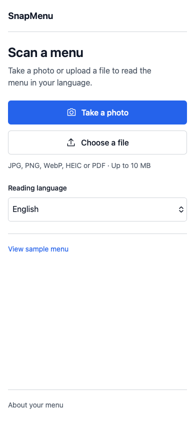

# SnapMenu

Photograph a restaurant menu, read it in your language, and generate an image of an unfamiliar dish. SnapMenu is a mobile web app with a plain interface, system fonts, and no account requirement.

## Current product

- Take a photo or upload JPEG, PNG, WebP, HEIC/HEIF, AVIF, or a PDF with up to three pages. Maximum upload: 10 MB.
- **GPT-6 Luna** reads and translates the menu into validated structured data.
- Original names, descriptions, categories, and printed price variants remain available. Unreadable or failed scans show an error, never a substitute menu.
- Search dishes, filter categories, save personal picks, and get a random course-by-course suggestion.
- **GPT Image 2.5 Flare** generates a dish image only when requested. Images are labeled as AI interpretations.
- Image tasks resume after reloads and server restarts. Completed pictures are stored privately alongside menus.
- Menus are accessible only to the originating browser session and expire after seven days. Original uploads are not retained by SnapMenu.



The interface uses English. Menu reading supports English, Chinese, Spanish, Hindi, Arabic, Portuguese, Russian, Japanese, German, and French.

## Run locally

Use Python 3.12 or later. There is one Python process and no frontend build step.

```sh
python3.12 -m venv .venv
source .venv/bin/activate
pip install -r requirements.txt
```

Create `.env` from `.env.example` if one does not exist. Otherwise, update the existing file without overwriting unrelated settings:

```dotenv
OPENAI_API_KEY=your_active_project_key
OPENAI_MENU_MODEL=gpt-6-luna
OPENAI_IMAGE_MODEL=gpt-image-2.5-flare
```

```sh
python -m uvicorn app:app --host 0.0.0.0 --port 8000
```

Open [localhost:8000](http://localhost:8000). A clearly labeled sample menu works without an API key. A configured key must have active account access and access to both models.

To test on your phone, use your computer's local IP address and port 8000 on the same network. Use HTTPS for a hosted release.

## Models and persistence

The defaults follow the current [GPT-6 Luna model documentation](https://developers.openai.com/api/docs/models/gpt-6-luna) and [GPT Image 2.5 Flare model documentation](https://developers.openai.com/api/docs/models/gpt-image-2.5-flare). Flare fits single-dish visualization; Sunburst targets more precise image editing. Model settings are server-side.

Menu extraction uses the Responses API with strict JSON schema output and `store=false`. Dish images use a forced image-generation tool in a background Response. Luna handles the request; Flare generates the image at 1024 × 1024, medium quality. This adds mainline-model usage to image generation costs, but provides a retrievable task ID for interruption recovery.

SnapMenu saves returned image bytes as private WebP files and requests deletion of completed OpenAI image responses. Background image requests use `store=true`; OpenAI's account retention settings apply until deletion, including when cleanup fails. See [architecture](docs/architecture.md) for the trade-offs.

SQLite and pictures live in `DATA_DIR` (default `./data`). Deploy **one worker and one replica** on persistent storage. The app retains request budgets across restarts. Old Neon data remains untouched. Old pending Runway jobs are marked unavailable and are never resubmitted automatically; existing saved images remain readable.

## Verification status

The October 27 local run passed **31 Chromium, WebKit, and API checks**. Browser acceptance drives the real HTTP app, upload codecs, private sessions, SQLite, and image persistence. Only OpenAI responses are simulated. See [verification](docs/verification.md) for the final results and remaining release checks.

```sh
pip install -r requirements-dev.txt
python -m playwright install chromium webkit
pytest --browser chromium --browser webkit
```

On October 27, 2026, the existing local key was tested against the two model metadata endpoints. Both returned HTTP 401 with `account_deactivated`. **An active OpenAI project key is required for live use.** No live menu extraction or dish-image generation was completed. No hosted deployment was verified.

## Decisions API

The current **Help me choose** button makes a random course selection. A useful next version could use the Decisions API to rank actual menu dishes against a diner's preferences. It could also flag unreadable photos before attempting extraction. Decisions returns constrained choices, scores, or probabilities; full menu extraction still belongs in Responses with Structured Outputs.

See the [concrete integration proposal](docs/decisions.md) for request examples, trade-offs, validation, and evaluation. This proposal is documented; it does not add another paid call to the current app.

## Project docs

- [Product specification](docs/product.md)
- [Architecture and OpenAI contracts](docs/architecture.md)
- [Deployment, backup, recovery, and diagnostics](docs/operations.md)
- [Release plan](docs/plan.md)
- [Revival history and handoff](docs/pls-fix.md)

The competing Streamlit, Pixtral, FLUX, Fireworks, and Runway implementations are retired. Git history preserves the original implementation. Existing Neon resources need a separate data review before deprovisioning.
